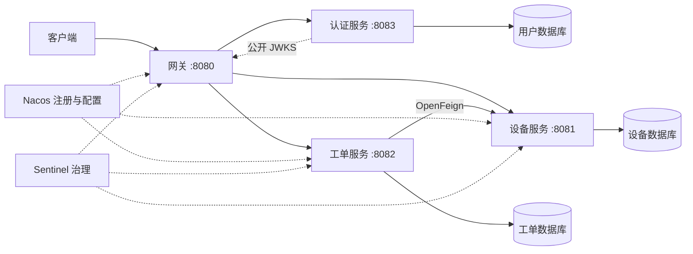

# 智能制造微服务框架

[](https://github.com/Akarin7784/smart-manufacturing-cloud/actions/workflows/build.yml)

项目长期开发约定见 [AGENTS.md](AGENTS.md)：后续新增或修改的代码必须添加并维护中文注释。

基于 Spring Cloud Alibaba 的 Maven 多模块项目，提供可运行的认证服务、网关、设备服务、工单服务及基础设施。核心功能已实现；这是业务开发起点，不是完整的 MES 产品。

## 技术与模块

| 组件 | 版本 / 用途 |
| --- | --- |
| Java | 21 |
| Spring Boot | 3.5.0 |
| Spring Cloud | 2025.0.0 |
| Spring Cloud Alibaba | 2025.0.0.0 |
| Nacos | 3.0.3，注册发现、配置刷新 |
| Sentinel | 1.8.9，网关限流、Feign 降级 |
| Spring Cloud Gateway | WebFlux 网关，服务名负载均衡 |
| OpenFeign + LoadBalancer | 工单服务调用设备服务 |
| JDBC + MySQL | 各服务独立数据库与账号 |
| H2 | 无中间件本地开发，数据保存于 data/ |
| Actuator + Prometheus | 健康检查与受保护的指标 |
| Spring Security + RSA JWT | 独立登录、三种角色、网关与服务分别验签 |

版本依据：[阿里巴巴官方兼容表](https://sca.aliyun.com/docs/2025.x/overview/version-explain/)。版本集中在根 pom.xml；升级时必须一起核对 Boot / Cloud / Alibaba 兼容性。



- cloud-api：公共响应、DTO 与服务契约，不依赖 Web 框架。
- cloud-security：跨 Servlet / WebFlux 共享 JWT 声明校验与权限映射。
- auth-service：账号登录、公钥发布、当前身份、管理员用户管理，独立认证库。
- cloud-common：Servlet 服务的异常处理、请求 ID、Sentinel HTTP 429 响应。网关不引用此模块。
- cloud-gateway：显式路由 /api/auth/**、/api/devices/**、/api/workorders/**，移除 /api 前缀。
- device-service：设备查询、持久化、Nacos 动态配置示例。
- workorder-service：工单校验、Feign 调用、持久化与降级。
- masterdata-service：物料、工作中心/工位、版本化多层 BOM、工艺路线；demo profile 加载 GR-60 演示主数据（端口 8084）。
- infra：Nacos 配置样例、MySQL 初始化、Sentinel 控制台镜像。
- scripts：Windows 启停、配置导入、冒烟检查。
- docs：部署与扩展说明。

## 1. 不依赖 Docker 的本地启动

需要 JDK 21；Maven Wrapper 首次运行会下载 Maven 3.9.9。以下命令在项目根目录 PowerShell 执行：

```powershell
.\mvnw.cmd -B -ntp verify
powershell -ExecutionPolicy Bypass -File .\scripts\start-local.ps1
powershell -ExecutionPolicy Bypass -File .\scripts\smoke-test.ps1
```

默认 local profile 使用 H2 文件数据库、固定服务地址，关闭 Nacos 和 Sentinel。首次启动会生成管理员随机密码到被忽略的 .env，管理员用户名为 admin；不会重置已有用户。日志位于 .runtime/。脚本启动后台 Java 进程，停止方式：

```powershell
powershell -ExecutionPolicy Bypass -File .\scripts\stop-local.ps1
```

也可以在 PowerShell 先加载引导密码后分别运行四个服务：
```powershell
& .\scripts\init-auth.ps1
java -jar auth-service/target/auth-service-1.0.0-SNAPSHOT.jar
java -jar device-service/target/device-service-1.0.0-SNAPSHOT.jar
java -jar workorder-service/target/workorder-service-1.0.0-SNAPSHOT.jar
java -jar cloud-gateway/target/cloud-gateway-1.0.0-SNAPSHOT.jar
```

## 2. Alibaba 完整开发环境

### 一条命令启动演示环境（推荐）

需要 Docker（含 Compose v2），端口 3306、8080、8848、9848、8849、8858 空闲；冒烟测试依赖 curl 与 jq。

```bash
make demo          # 或 sh scripts/demo.sh；Windows：powershell -ExecutionPolicy Bypass -File .\scripts\demo.ps1
make smoke         # 对已运行环境重新冒烟
make demo-down     # 停止，保留数据
make demo-reset    # 删除数据卷后重建
```

`make demo` 会：缺少 `.env` 时从 `.env.example` 生成并填充随机密钥（`.env` 不入库）→ 构建并启动全部容器 → `db-init` 初始化数据库账号、`nacos-config-init` 初始化 Nacos 管理员并导入 `infra/nacos` 配置 → 等待所有业务服务 healthy（网关在下游 healthy 后才启动）→ 运行 `scripts/smoke-test.sh`。Nacos 已开启鉴权，控制台账号为 `.env` 中的 `NACOS_USERNAME`/`NACOS_PASSWORD`。已有旧数据卷时如出现 Nacos 登录失败，执行 `make demo-reset`。

### 本机运行服务（便于 IDE 调试）

```powershell
powershell -ExecutionPolicy Bypass -File .\scripts\init-env.ps1
docker compose up -d --build --wait nacos mysql sentinel db-init nacos-config-init
powershell -ExecutionPolicy Bypass -File .\scripts\start-local.ps1 -Profile cloud -SkipBuild
powershell -ExecutionPolicy Bypass -File .\scripts\smoke-test.ps1
```

本机运行服务有利于 IDE 调试。cloud profile 的网关用 lb:// 服务名路由，Feign 不指定 URL，从 Nacos 获取实例。

| 地址 | 说明 |
| --- | --- |
| http://localhost:8080/api/auth/login | JSON 账号登录，POST |
| http://localhost:8080/api/auth/me | 当前身份，需 Bearer 令牌 |
| http://localhost:8080/api/devices | 设备列表，需查询权限 |
| http://localhost:8080/api/workorders | 工单列表 / 创建 |
| http://localhost:8080/actuator/health | 网关健康 |
| http://localhost:8081/actuator/prometheus | 设备指标，需管理员令牌（容器模式不暴露业务端口） |
| http://localhost:8849 | Nacos 3 控制台 |
| http://localhost:8858 | Sentinel 控制台，sentinel / sentinel |

### 全部容器化

```bash
make demo
docker compose --profile app logs -f auth gateway device workorder
```

容器模式只暴露网关与开发基础设施端口；业务服务使用容器内部端口。本机 Java 服务与 app profile 不要同时运行，以免 Nacos 出现两套实例。停止容器但保留数据：

```powershell
docker compose --profile app down
```

## 3. 验证业务链路

种子设备 D001 在线，D002 离线。

```powershell
& .\scripts\init-auth.ps1
$login = Invoke-RestMethod http://localhost:8080/api/auth/login -Method Post -ContentType 'application/json' -Body (
    @{username='admin';password=$env:AUTH_BOOTSTRAP_PASSWORD} | ConvertTo-Json -Compress)
$headers = @{Authorization="Bearer $($login.data.accessToken)"}
Invoke-RestMethod http://localhost:8080/api/devices/D001 -Headers $headers
# 创建工单必须携带 Idempotency-Key；同一业务请求重试时复用同一个键（重放返回 200 与首次结果，同键不同内容返回 422）。
Invoke-RestMethod http://localhost:8080/api/workorders -Headers ($headers + @{'Idempotency-Key'=[guid]::NewGuid().ToString()}) -Method Post -ContentType 'application/json' -Body '{"deviceId":"D001","product":"bearing","quantity":10}'
Invoke-RestMethod http://localhost:8080/api/workorders -Headers $headers
```

创建成功返回 HTTP 201，响应格式：
```json
{"code":"OK","message":"success","data":{"id":"uuid","deviceId":"D001","product":"bearing","quantity":10,"status":"CREATED"}}
```

所有业务 API 先校验 Bearer JWT；未登录或令牌无效返回 401，权限不足返回 403。身份与权限通过后，无效数量返回 400；设备不存在返回 404；设备离线返回 409；设备服务故障返回 503，且不插入工单。网关生成 X-Request-Id，跨 Feign 调用传播，服务日志可按 ID 关联。它是请求关联 ID，尚未接入完整分布式 tracing。

工单只写本服务数据库，因此不使用分布式事务。设备查询与工单插入之间不保证设备状态原子性；未来若要占用设备或扣库存，应采用资源预留、幂等处理及明确的补偿/事务方案。

## 4. Nacos 动态配置与 Sentinel

Nacos namespace 默认 public（namespace ID 留空），配置 Group 为 MANUFACTURING。使用 application-cloud.yml 中 spring.config.import 加载配置，无 bootstrap.yml。

导入后访问：
```powershell
Invoke-RestMethod http://localhost:8080/api/devices/config -Headers $headers
```
在 Nacos 修改 device-service.yml 的 demo.welcome 后，无需重启服务，接口会读到新值。

Sentinel 控制台展示 cloud 服务；先请求接口产生资源。可为网关路由 device-service / workorder-service 添加 QPS 规则，或为业务 HTTP 资源添加限流规则。阻断返回 HTTP 429 与 RATE_LIMITED。Feign 启用 Sentinel fallbackFactory，设备服务异常时拒绝创建工单。

**控制台规则默认在内存中，重启会丢失。** 若需要持久化规则，见 docs/architecture.md；本骨架没有把控制台规则自动同步到 Nacos。

## 5. 测试与后续开发

GitHub Actions 在每次推送、PR 和手动触发时执行 Linux / Windows 的 Java 21 全模块构建与测试，并保留测试报告和四个可执行服务 JAR。配置见 [.github/workflows/build.yml](.github/workflows/build.yml)。

```powershell
.\mvnw.cmd -B -ntp verify
```

自动测试覆盖真实 RSA 验签、有效期/签发者/受众、权限拒绝、登录锁定、公钥脱敏、密码散列、用户管理、网关路由和工单业务回归。单元/集成测试不要求运行 Nacos、MySQL；冒烟脚本验证真实进程之间的 HTTP 和 Feign 链路。

添加新服务时复制业务服务结构，设置唯一 application.name / 端口 / 数据库，新增网关显式路由与 Nacos Data ID；API 契约放 cloud-api，避免共享各服务数据库。

## 使用边界

Compose 使用仅限本机的端口绑定，Nacos 关闭鉴权、MySQL 使用开发密码，业务 API 已实现账号认证和角色权限控制。上线前补充企业身份接入（按需）、租户/数据权限、TLS、密钥轮换、数据库迁移、监控告警、备份以及 Nacos 高可用。详情见 docs/architecture.md。RocketMQ 与 Seata 在扩展说明中给出设计接入位置，当前没有启用这两个组件。

## 认证授权

详细接口、权限表、引导密码与令牌生命周期见 [docs/authentication.md](docs/authentication.md)。

```powershell
powershell -ExecutionPolicy Bypass -File .\scripts\security-smoke-test.ps1
```

该脚本验证管理员、操作员和查看者的权限边界，拒绝伪造角色请求头与篡改签名。测试创建的账号会被禁用，示例工单保留。

## 接口变更说明

- **破坏性变更（工单幂等，PR #9）**：`POST /api/workorders` 必须携带 `Idempotency-Key` 请求头（1–128 位 `[A-Za-z0-9._:-]`），缺失或格式非法返回 400 `IDEMPOTENCY_KEY_REQUIRED`。首次创建返回 201；同键同内容重放返回 200 及首次结果（响应头 `Idempotent-Replayed: true`）；同键不同内容返回 422 `IDEMPOTENCY_KEY_REUSED`。幂等记录保留 7 天，过期后同键视为新请求。外部调用方升级时请为每个业务请求生成唯一键，重试时复用。
