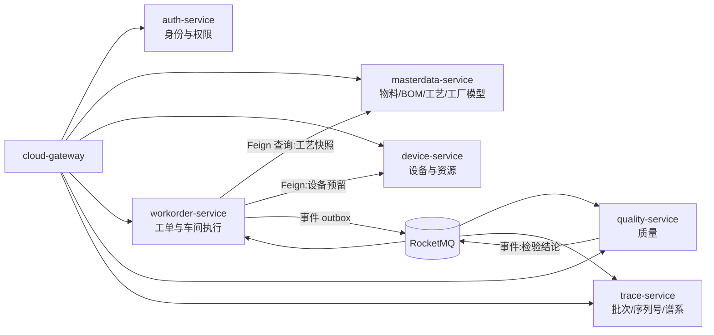

# MES 产品与领域设计（演示产品：GR-60 小型齿轮减速机）

> 文档状态：设计稿 v0.1（仅设计，不含业务代码）
> 适用仓库：smart-manufacturing-cloud（Java 21 / Spring Boot 3.5.0 / Spring Cloud 2025.0.0 / Spring Cloud Alibaba 2025.0.0.0）
> 读者：评审工程师、产品负责人、后续实现者

## 0. 背景与约束

### 0.1 现有仓库事实（设计输入）

| 事实 | 对设计的影响 |
| --- | --- |
| 模块：cloud-gateway、auth-service、device-service、workorder-service、cloud-api、cloud-common、cloud-security | 新服务沿用同一结构：`xxx-service` + 契约放 `cloud-api` + Servlet 公共组件放 `cloud-common` |
| 每个业务服务独立数据库、独立 MySQL 账号，**无跨库外键** | 跨上下文只引用业务编码（物料编码、设备编码、工单号），通过 Feign 查询或事件快照获取数据 |
| 工单状态机已实现 CREATED/RELEASED/IN_PROGRESS/ON_HOLD/COMPLETED/CANCELLED（CLOSED 仅作报工守卫，尚无关闭入口）；创建时仍同步查询设备 `ONLINE` | 派工设计见 docs/workorder-dispatch-design.md；“读设备状态≠预留资源”已在 AGENTS.md 明确，派工阶段需引入预留 + 幂等 + 补偿 |
| 权限为 `资源:动作` 字符串（`workorder:write` 等），ADMIN/OPERATOR/VIEWER 三角色，网关与服务双重校验 | 新模块按同一命名扩展权限，并补充角色（工艺员、质检员、班组长）；每个新接口须同步网关规则与越权测试 |
| docs/architecture.md 建议 outbox + RocketMQ 5.3.1、Seata 2.5.0 仅在确有跨服务同步写入时引入 | 生产过程优先采用**本地事务 + outbox + 最终一致**；不在报工主链路引入全局事务 |
| schema.sql 仅为开发初始化，上线改 Flyway/Liquibase | 每个新服务从第一天起使用 Flyway 迁移，演示主数据用独立的 `R__demo_data.sql`（可重复迁移，仅 demo profile 执行） |
| AGENTS.md 要求中文注释、中文 Javadoc | 后续实现的代码、SQL、YAML 统一中文注释 |

### 0.2 设计原则

1. **主数据版本化、执行数据快照化**：工单下达时冻结 BOM 版本与工艺路线版本，后续主数据变更不影响在制工单。
2. **服务按限界上下文切分，不按表切分**：避免“物料服务、BOM 服务、工序服务”这类贫血微服务。
3. **过程数据只追加**：报工、投料、检验、追溯记录不可物理修改，更正采用冲销记录（reversal）。
4. **一切写接口可幂等**：PDA/工控机/PLC 网关存在重复提交，写接口要求 `Idempotency-Key` 或业务唯一键。
5. **降级不得伪造业务成功**（沿用现有约定）。

---

## 1. 功能地图（对标主流 MES）

### 1.1 对标产品与参考点

| 产品 | 定位 | 借鉴点 |
| --- | --- | --- |
| SAP Digital Manufacturing（DMC，前身 SAP ME） | 离散制造云 MES，与 S/4HANA 集成 | SFC（车间流转单元）概念、工序活动（Start/Complete/Hold）、POD 工作台、装配数据收集、不合格代码（NC Code） |
| Siemens Opcenter Execution Discrete | 高端离散 MES | 工艺路线版本与有效期、电子作业指导（EWI）、As-Built 装配记录、质量检验计划 |
| Rockwell Plex / FactoryTalk ProductionCentre | 云原生 MES + 质量 + 追溯 | 容器/标签驱动的物料流转、实时库存、控制计划（Control Plan）、OEE |
| 鼎捷 MES（sMES） | 国内离散加工、机加/电子 | 派工单、报工、首件检、工序委外、看板 |
| 用友 U9/YonBIP MES、金蝶云星空/星瀚 MES | ERP 一体化 MES | 生产订单—工序计划—工序汇报、领料/倒冲、与 ERP 入库成本对接 |

> 说明：对标为功能层面的公开资料归纳，不代表复刻上述产品实现细节。

### 1.2 本系统功能地图

| 一级模块 | 二级功能 | 对标参考 | 阶段 |
| --- | --- | --- | --- |
| 工厂建模 | 工厂/车间/产线/工作中心/工位、班次日历 | ISA-95 设备层级，Opcenter | P1 |
| 物料与 BOM | 物料主数据、计量单位、追溯属性、多层 BOM、版本与生效日期、替代料 | SAP、用友 | P1 |
| 工艺管理 | 工艺路线、工序、工序资源、标准工时、作业指导、数据采集项、检验点挂接 | DMC Routing、Opcenter | P1 |
| 设备管理 | 设备台账、状态（运行/待机/故障/保养）、点检、保养计划、OEE | Plex、FactoryTalk | P1（台账/状态）/P3（OEE） |
| 生产订单/工单 | 工单创建、下达、拆分、暂停、关闭、BOM/工艺快照 | DMC Shop Order、金蝶生产订单 | P1 |
| 车间执行 | 派工、开工、完工、报工（合格/不良/报废）、工序流转、工位工作台 | DMC POD/SFC、鼎捷报工 | P2 |
| 物料执行 | 领料、上料扫码校验、投料记录、倒冲、线边库 | Plex 容器管理 | P2 |
| 质量管理 | 检验计划、首检/巡检/末检、IQC/FQC/OQC、不合格品处置（MRB）、SPC | Opcenter Quality、Plex Control Plan | P2（检验/NC）/P3（SPC） |
| 追溯 | 批次、序列号、装配谱系（As-Built）、正向/反向追溯、召回范围分析 | DMC Genealogy、Opcenter As-Built | P2 |
| 包装与标签 | 产品标签、箱码、装箱关系 | Plex 容器 | P3 |
| 看板与分析 | 生产进度、良率、直通率（FPY）、OEE、在制品 | 各产品通用 | P3 |
| 集成 | ERP 订单下发/完工回传、PLC/IoT 采集（OPC UA/MQTT） | 各产品通用 | P4 |
| 平台 | 认证授权、审计日志、编码规则、消息 | 已有 auth/gateway | P0（已完成）/P1 |

**明确不做（范围外）**：APS 高级排程（仅提供简单的工位派工）、WMS 全功能、成本核算、PLM 设计变更流程（只接收 ECN 结果，即新版本 BOM/工艺）。

---

## 2. 领域模型与限界上下文

### 2.1 上下文划分与服务映射



| 限界上下文 | 服务 | 现状 | 核心聚合 | 数据库 |
| --- | --- | --- | --- | --- |
| 身份与权限 | auth-service | 已有 | User、Role | manufacturing_auth |
| 主数据（物料、BOM、工艺、工厂模型） | **masterdata-service**（新增） | 无 | Material、Bom(版本)、Routing(版本)、WorkCenter、Station | manufacturing_md |
| 设备与资源 | device-service（扩展） | 仅 id/name/status | Equipment、EquipmentReservation、MaintenancePlan | manufacturing_device |
| 生产执行 | workorder-service（扩展） | 仅创建/查询 | WorkOrder、OperationTask（工序任务）、Report（报工）、MaterialConsumption | manufacturing_workorder |
| 质量 | **quality-service**（新增） | 无 | InspectionPlan、InspectionRecord、NonConformance | manufacturing_quality |
| 追溯 | **trace-service**（新增） | 无 | Lot、SerialUnit、GenealogyLink | manufacturing_trace |

**取舍说明**

- 工厂模型（工作中心、工位）放主数据，**设备实例**放 device-service：工艺路线引用的是“工作中心/工位能力”，而设备状态、预留、保养属于高频变化的运行态数据，生命周期不同。工位→设备的绑定关系由 device-service 维护（设备的 `station_code` 字段）。
- 车间执行与工单不拆分：工序任务与工单状态强一致（工单完工依赖末道工序完工），拆开会引入大量分布式一致性问题。待单服务成为瓶颈时再按读写分离演进。
- 追溯独立：谱系查询是图/树遍历，数据量随产量线性增长，且被质量、售后共同使用，适合独立存储（P3 可评估迁移到图数据库或 ClickHouse）。
- 库存/线边库在 P2 作为 workorder-service 内的子模块（线边批次余量），不建独立 WMS；如需对接真实 WMS 走集成层。

### 2.2 核心领域对象（摘要）

```mermaid
classDiagram
  class Material { code; name; type; uom; traceMode(NONE/LOT/SERIAL); shelfLifeDays }
  class Bom { productCode; version; status(DRAFT/RELEASED/OBSOLETE); effectiveFrom; effectiveTo }
  class BomLine { lineNo; componentCode; qtyPer; uom; scrapRate; issueMode(PICK/BACKFLUSH); consumeOpNo; phantom }
  class Routing { productCode; version; status; }
  class Operation { opNo; name; workCenterCode; stdSetupMin; stdRunSecPerPcs; reportPoint; inspectionPointCodes }
  class WorkOrder { orderNo; productCode; plannedQty; bomVersion; routingVersion; status; lotNo }
  class OperationTask { orderNo; opNo; status; goodQty; scrapQty; reworkQty; stationCode }
  class Lot { lotNo; materialCode; qty; status(AVAILABLE/HOLD/CONSUMED/SCRAPPED) }
  class SerialUnit { sn; materialCode; orderNo; status }
  class GenealogyLink { parentId; childId; childType(LOT/SN); qty; opNo; timestamp }
  Bom "1" *-- "n" BomLine
  Routing "1" *-- "n" Operation
  WorkOrder "1" *-- "n" OperationTask
  SerialUnit "1" o-- "n" GenealogyLink
```



关键不变量：

- 同一产品同一时刻只有一个 RELEASED 且在有效期内的 BOM/工艺版本；RELEASED 版本不可修改，只能升版。
- BOM 行的 `consumeOpNo` 必须存在于同产品生效工艺路线中（发布时跨聚合校验，均在 masterdata-service 内）。
- 工单快照：下达时将 BOM 展开结果与工序列表复制到 workorder-service 的 `wo_bom_snapshot`、`operation_task`，后续不再回查主数据。
- 工序数量不变量（报工接口校验依据）：对第 n 道工序（n>1），`good(n) + scrap(n) + pendingRework(n) ≤ good(n-1) + reworkReturn(n)`。
  - `good(n-1)`：上道累计合格数（已转出到本道的可加工数）；首道工序以工单计划数×(1+超交容差) 代替。
  - `scrap(n)`：本道累计报废；`pendingRework(n)`：本道判返工且尚未返回的数量（已离开合格流，但未消失）。
  - `reworkReturn(n)`：返工完成后回流到本道重新加工的数量（返工件不重复计入上道合格数）。
  - 示例：上道合格 10，本道已报合格 8、报废 2，则本道再报任何数量都返回 422 `over-report`；若其中 1 件返工回流，则可再报 1 件。
  - 每次报工在同一事务内以 `version` 乐观锁更新 operation_task 累计值，保证并发报工下不变量成立。
- 追溯属性为 SERIAL 的物料装配必须扫描序列号；LOT 的必须扫描批次；NONE 只记数量。

### 2.3 关键事件（outbox）

| 事件 | 发布者 | 消费者 | 用途 |
| --- | --- | --- | --- |
| WorkOrderReleased | workorder | trace（预生成批次/SN 段）、quality（生成首检任务） | 下达后准备 |
| OperationStarted / OperationCompleted | workorder | quality（触发检验）、device（运行统计） | 过程联动 |
| MaterialConsumed | workorder | trace（写谱系） | 追溯 |
| InspectionConcluded（PASS/FAIL） | quality | workorder（解除/保持工序门禁） | 质量门禁 |
| NonConformanceDisposed（返工/报废/让步） | quality | workorder（生成返工任务/报废记录） | MRB |
| EquipmentStatusChanged | device | workorder（故障时暂停相关任务提示） | 设备联动 |

事件统一包含 `eventId`、`occurredAt`、`aggregateId`、`version`；消费者以 `eventId` 幂等落表（`consumed_event`），失败重试后进入死信并告警。

### 2.4 权限扩展（沿用 `资源:动作`）

| 新权限 | ADMIN | PLANNER 计划员 | ENGINEER 工艺员 | OPERATOR 操作工 | QC 质检员 | VIEWER |
| --- | --- | --- | --- | --- | --- | --- |
| masterdata:read | ✔ | ✔ | ✔ | ✔ | ✔ | ✔ |
| masterdata:write / masterdata:release | ✔ | | ✔ | | | |
| workorder:write（创建/下达/关闭） | ✔ | ✔ | | | | |
| execution:report（开工/报工/投料） | ✔ | | | ✔ | | |
| quality:inspect / quality:dispose | ✔ | | | | ✔ | |
| trace:read | ✔ | ✔ | ✔ | ✔ | ✔ | ✔ |
| device:write | ✔ | | ✔ | | | |

> 兼容策略：现有 OPERATOR 拥有 `workorder:write`。P1 起新增执行类接口只认 `execution:report`，OPERATOR 的 `workorder:write` 在 P1 期间保留（仅对现有 `POST /work-orders` 生效，标记为 deprecated）；**P2 发布时移除**，计划类接口改由 PLANNER 承担。越权测试在 P1 覆盖新旧两套权限（OPERATOR 仍可调用旧接口、不可调用下达/关闭），P2 增加“OPERATOR 调用旧接口返回 403”用例。

---

## 3. 工单状态机

### 3.1 工单（WorkOrder）

```mermaid
stateDiagram-v2
  [*] --> CREATED: 创建
  CREATED --> RELEASED: 下达 [BOM/工艺已发布且有效; 快照成功]
  CREATED --> CANCELLED: 取消
  RELEASED --> IN_PROGRESS: 首道工序开工 [设备预留成功; 首检任务已生成]
  RELEASED --> ON_HOLD: 冻结 [LotHeld 涉及快照物料/人工; 记录 resumeTarget=RELEASED]
  RELEASED --> CANCELLED: 取消 [无任何报工/投料]
  RELEASED --> CREATED: 撤回下达 [无任何报工/投料; 释放预留]
  IN_PROGRESS --> ON_HOLD: 暂停 [质量冻结/设备故障/人工]
  ON_HOLD --> IN_PROGRESS: 恢复 [冻结原因全部解除 且 resumeTarget=IN_PROGRESS]
  ON_HOLD --> RELEASED: 恢复 [冻结原因全部解除 且 resumeTarget=RELEASED]
  ON_HOLD --> CANCELLED: 取消 [resumeTarget=RELEASED; 无报工/投料]
  IN_PROGRESS --> COMPLETED: 完工 [计划×(1-欠交容差) ≤ 末道合格数 ≤ 计划×(1+超交容差), 或人工确认短交; 无 RUNNING/WAITING_INSPECTION 任务]
  COMPLETED --> IN_PROGRESS: 反完工 [未入库; 审批]
  COMPLETED --> CLOSED: 关闭 [无未处置不合格品; 投料差异已确认]
  CANCELLED --> [*]
  CLOSED --> [*]
```



| 转换 | 触发者/接口 | 守卫条件 | 副作用 |
| --- | --- | --- | --- |
| CREATED→RELEASED | 计划员 `POST /work-orders/{no}/release` | 产品存在生效 BOM、工艺版本；计划数>0；计划日期合法 | 冻结 BOM 展开与工序到快照；生成 OperationTask（首道 READY，其余 PENDING，与 3.2 一致）；整单预留物料；发 WorkOrderReleased。分配批次号归入 P4（TODO，P2 未实现） |
| RELEASED→IN_PROGRESS | 首次 `OperationStarted` 内部触发 | 由工序开工守卫保证 | 记录实际开工时间 |
| RELEASED/IN_PROGRESS→ON_HOLD | 人工 / LotHeld / InspectionConcluded(FAIL，FAI 失败) / EquipmentStatusChanged(FAULT) | 仅允许从 RELEASED、IN_PROGRESS 进入；CREATED 无需冻结（未下达不可执行），COMPLETED 及以后不冻结工单而是冻结批次/SN | 首次进入时记录 `resume_target`（RELEASED 或 IN_PROGRESS）；维护 `hold_reason` 集合（可多原因并存，按来源去重）；所有 RUNNING 任务转 PAUSED 并释放设备预留（归入 P4，TODO：P2 尚无 RUNNING 任务与设备预留实现）|
| ON_HOLD→RELEASED / IN_PROGRESS | 人工/事件 | `hold_reason` 集合为空；目标状态 = `resume_target` | 任务不自动恢复，需操作工确认重新开工（重新预留设备） |
| IN_PROGRESS→COMPLETED | 末道报工自动或计划员手动 | 末道合格数在 [计划×(1-欠交容差), 计划×(1+超交容差)]；超交上限同时在报工接口拦截（首道可加工数上限）；手动短交需填写原因 | 发 WorkOrderCompleted（P4 回传 ERP） |
| COMPLETED→CLOSED | 计划员 | 无 OPEN 的 NonConformance；投料差异（理论用量 vs 实际）已确认 | 只读归档 |

并发与一致性：

- 工单行使用 `version` 乐观锁；状态转换写法为 `update ... set status=?, version=version+1 where order_no=? and status=? and version=?`，影响 0 行即返回 409 `WORK_ORDER_STATE_CONFLICT`。
- 每次转换写入 `work_order_status_log`（from、to、reason、operator、requestId），用于审计。

### 3.2 工序任务（OperationTask）

```mermaid
stateDiagram-v2
  [*] --> PENDING
  PENDING --> READY: 上道工序有合格数流入 / 首道工序且工单已下达
  READY --> RUNNING: 开工 [工位绑定设备 ONLINE 且预留成功; 上料校验通过; 首件检门禁]
  RUNNING --> PAUSED: 暂停
  PAUSED --> RUNNING: 恢复
  RUNNING --> READY: 部分报工后下班/换班（数量累计）
  RUNNING --> WAITING_INSPECTION: 报工累计(合格+报废+待返工) = 可加工数 [存在未结案检验点]
  RUNNING --> DONE: 报工累计 = 可加工数 [无检验点或检验已全部结案]
  WAITING_INSPECTION --> DONE: InspectionConcluded(PASS)
  WAITING_INSPECTION --> READY: InspectionConcluded(FAIL) → NC 处置为返工回流
  WAITING_INSPECTION --> DONE: NC 处置为报废/让步（数量按处置结果修正）
  RUNNING --> PAUSED: 设备预留过期 / 工单 ON_HOLD
  DONE --> [*]
```



- `WAITING_INSPECTION`：数量已报满、检验结论未回。此时**释放设备预留**（设备可加工下一任务），任务不可再报工。
- 下道 READY 的触发：按“已放行合格数”流转，而非报工合格数。无检验点或检验点为自动判定（压装/拧紧，同步产生结论）的工序，报工合格即放行；人工检验点的工序，`InspectionConcluded(PASS)` 后才把对应数量转为上道放行数，触发下道 PENDING→READY。巡检类（抽样 1/30）不阻塞放行，FAIL 时通过 LotHeld 追溯隔离。
- 检验结论超时（默认 4 小时未回）产生告警，不自动放行。

首件检门禁：工序标记 `firstArticleRequired=true` 时，开工后只允许报工 1 件，首件检 PASS 后才放开批量报工。

### 3.3 设备预留（解决“读状态≠占用”）

1. 开工时 workorder 调用 `POST /devices/{code}/reservations`（携带 `Idempotency-Key = orderNo:opNo:attemptId`），device-service 以条件更新获得占用（同一设备同一时刻至多一个 ACTIVE 预留）。
2. 预留成功后 workorder 本地事务写 RUNNING；若本地写失败，调用释放接口补偿，并有 TTL 兜底。
3. **续约**：TTL 默认 15 分钟，续约责任方是**处于 RUNNING 的工序任务**（workorder-service 内定时任务，每 5 分钟对本服务所有 RUNNING 任务批量调用 `PUT /devices/{code}/reservations/{id}/renew`）；报工请求同时顺带续约。续约不依赖工位客户端在线，因此磨齿 600 s/件等长工序不会因无报工而过期。续约连续失败 2 次产生告警。
4. **过期处理**：device-service 侧预留过期即转 EXPIRED 并发布 `ReservationExpired`；workorder 消费后将对应任务 RUNNING→PAUSED（原因 `RESERVATION_EXPIRED`）并告警班组长，已报数量保留；恢复需重新预留，不允许“任务 RUNNING 但无有效预留”。续约接口对已 EXPIRED 的预留返回 409，workorder 同样走上述 PAUSED 流程（事件丢失时的兜底）。
5. 任务进入 PAUSED、WAITING_INSPECTION、DONE 或工单 ON_HOLD 时主动释放预留。
3. Feign 降级或超时：开工失败并提示“无法确认设备占用”，**不会**乐观开工。

---

## 4. 演示主数据：GR-60 小型齿轮减速机

产品：GR-60 二级圆柱斜齿轮减速机，中心高 60 mm，速比 i=20，输入 0.37 kW，输出扭矩约 120 N·m。产品 SN 级追溯，关键零件批次/序列号追溯。

### 4.1 物料主数据

| 物料编码 | 名称 | 类型 | 单位 | 追溯方式 | 来源 | 备注 |
| --- | --- | --- | --- | --- | --- | --- |
| FG-GR60-20 | GR-60 减速机 i=20 | 成品 FG | 台 | SERIAL | 自制 | 包装后成品 |
| SA-GR60-HSG | 箱体组件（含轴承外圈） | 半成品 SA | 件 | LOT | 自制 | 机加后箱体+压装 |
| SA-GR60-IN | 输入轴组件 | 半成品 SA | 件 | SERIAL | 自制 | 齿轮轴+轴承+油封 |
| SA-GR60-MID | 中间轴组件 | 半成品 SA | 件 | LOT | 自制 | |
| SA-GR60-OUT | 输出轴组件 | 半成品 SA | 件 | SERIAL | 自制 | 关键件 |
| PT-GR60-HSG | 箱体（机加） | 零件 | 件 | LOT | 自制 | |
| PT-GR60-COV | 端盖（机加） | 零件 | 件 | LOT | 自制 | |
| PT-GR60-G1 | 输入齿轮轴 m1.5 z13 | 零件 | 件 | SERIAL | 自制 | 热处理外协 |
| PT-GR60-G2 | 中间大齿轮 m1.5 z52 | 零件 | 件 | LOT | 自制 | |
| PT-GR60-G3 | 中间齿轮轴 m2 z15 | 零件 | 件 | LOT | 自制 | |
| PT-GR60-G4 | 输出大齿轮 m2 z75 | 零件 | 件 | LOT | 自制 | |
| PT-GR60-SHO | 输出轴 Φ20 | 零件 | 件 | SERIAL | 自制 | 激光打码 |
| RM-HT250-HSG | HT250 箱体铸件 | 原材料 | 件 | LOT | 采购 | 炉号即批次 |
| RM-HT250-COV | HT250 端盖铸件 | 原材料 | 件 | LOT | 采购 | |
| RM-20CrMnTi-D30 | 20CrMnTi 圆钢 Φ30 | 原材料 | kg | LOT | 采购 | 炉号 |
| RM-20CrMnTi-D90 | 20CrMnTi 锻坯 Φ90 | 原材料 | 件 | LOT | 采购 | |
| RM-40Cr-D25 | 40Cr 圆钢 Φ25 | 原材料 | kg | LOT | 采购 | |
| PP-BRG-6202 | 深沟球轴承 6202-2RS | 外购件 | 个 | LOT | 采购 | 供应商批次 |
| PP-BRG-6204 | 深沟球轴承 6204-2RS | 外购件 | 个 | LOT | 采购 | |
| PP-SEAL-15 | 油封 TC 15×30×7 | 外购件 | 个 | LOT | 采购 | |
| PP-SEAL-20 | 油封 TC 20×35×7 | 外购件 | 个 | LOT | 采购 | |
| PP-KEY-6 | 平键 6×6×20 | 标准件 | 个 | NONE | 采购 | |
| PP-BOLT-M6 | 内六角螺栓 M6×20 | 标准件 | 个 | NONE | 采购 | |
| PP-GASKET | 端盖密封垫 | 外购件 | 个 | NONE | 采购 | |
| PP-OIL-220 | 合成齿轮油 VG220 | 辅料 | L | LOT | 采购 | 倒冲 |
| PK-BOX-GR60 | 包装纸箱 | 包材 | 个 | NONE | 采购 | 倒冲 |
| PK-LBL-NP | 铭牌标签 | 包材 | 张 | NONE | 采购 | 打印时绑定 SN |

### 4.2 多层 BOM（版本 A01，生效 2026-10-01）

```text
FG-GR60-20  减速机                          1 台
├── SA-GR60-HSG  箱体组件                    1     [OP40 消耗]
│   ├── PT-GR60-HSG  箱体(机加)              1
│   │   └── RM-HT250-HSG  铸件               1     (损耗率 2%)
│   └── PP-BRG-6204   轴承 6204-2RS           2     (外圈压装)
├── SA-GR60-IN   输入轴组件                   1     [OP40 消耗]
│   ├── PT-GR60-G1   输入齿轮轴               1
│   │   └── RM-20CrMnTi-D30  圆钢            0.45 kg (损耗 5%)
│   ├── PP-BRG-6202  轴承                     2
│   └── PP-SEAL-15   油封                     1
├── SA-GR60-MID  中间轴组件                   1     [OP40 消耗]
│   ├── PT-GR60-G3   中间齿轮轴               1
│   │   └── RM-20CrMnTi-D30  圆钢            0.55 kg
│   ├── PT-GR60-G2   中间大齿轮               1
│   │   └── RM-20CrMnTi-D90  锻坯            1
│   ├── PP-KEY-6     平键                     1
│   └── PP-BRG-6202  轴承                     2
├── SA-GR60-OUT  输出轴组件                   1     [OP40 消耗]
│   ├── PT-GR60-SHO  输出轴                   1
│   │   └── RM-40Cr-D25  圆钢                0.60 kg
│   ├── PT-GR60-G4   输出大齿轮               1
│   │   └── RM-20CrMnTi-D90  锻坯            1
│   ├── PP-KEY-6     平键                     1
│   └── PP-SEAL-20   油封                     1
├── PT-GR60-COV  端盖(机加)                   1     [OP50 消耗]
│   └── RM-HT250-COV 铸件                     1
├── PP-GASKET    密封垫                       1     [OP50]
├── PP-BOLT-M6   螺栓                         6     [OP50, 倒冲]
├── PP-OIL-220   齿轮油                       0.25 L [OP60, 倒冲]
├── PK-LBL-NP    铭牌                         1     [OP80]
└── PK-BOX-GR60  包装箱                       1     [OP80, 倒冲]
```

说明：演示中一个工单只生产成品，半成品与零件通过各自的工单生产（多级工单，按层级下达）；为简化演示可启用“虚拟件（phantom）”模式把 SA 层展开到成品工单，两种模式由 BOM 行 `phantom` 标识决定。

### 4.3 工作中心 / 工位 / 设备

| 车间 | 工作中心 | 工位 | 设备编码 | 设备 | 说明 |
| --- | --- | --- | --- | --- | --- |
| 机加车间 W01 | WC-CNC 数控加工 | ST-CNC-01 | EQ-VMC-01 | 立式加工中心 VMC850 | 箱体/端盖 |
| | | ST-CNC-02 | EQ-LATHE-01 | 数控车床 CK6140 | 轴类车削 |
| | WC-GEAR 齿加工 | ST-HOB-01 | EQ-HOB-01 | 数控滚齿机 YK3150 | 滚齿 |
| | | ST-GRD-01 | EQ-GRD-01 | 齿轮磨齿机 | 输出齿轮磨齿 |
| | WC-HT 热处理（外协） | ST-HT-OUT | — | 外协供应商 | 渗碳淬火，委外工序 |
| | WC-MQC 机加检测 | ST-CMM-01 | EQ-CMM-01 | 三坐标测量机 | 关键尺寸 |
| 装配车间 W02 | WC-ASM 装配线 | ST-ASM-01 | EQ-PRESS-01 | 伺服压装机（带压力-位移曲线） | 轴承压装 |
| | | ST-ASM-02 | EQ-TQ-01 | 智能拧紧枪 | 端盖螺栓扭矩 |
| | | ST-ASM-03 | EQ-OIL-01 | 定量加油机 | 加油 |
| | WC-TEST 测试 | ST-TEST-01 | EQ-RUN-01 | 跑合测试台（噪声/温升/电流） | 100% 下线测试 |
| | | ST-LEAK-01 | EQ-LEAK-01 | 气密检测仪 | 泄漏测试 |
| | WC-PACK 包装 | ST-PACK-01 | EQ-LBL-01 | 标签打印机 | 铭牌/箱标 |
| | | | EQ-LASER-01 | 激光打标机（装配线首站） | 输出轴 SN 打码 |

现有 device-service 种子数据 `D001 数控加工中心`、`D002 工业机械臂` 在迁移中映射为 `EQ-VMC-01` 与保留 `D002` 作为离线场景演示设备（用于展示“设备离线不能开工”）。

### 4.4 工艺路线

**成品 FG-GR60-20（版本 R01）**

| 工序 | 名称 | 工作中心 | 准备(min) | 节拍(s/台) | 报工点 | 检验点 | 采集项 |
| --- | --- | --- | --- | --- | --- | --- | --- |
| OP10 | 物料齐套与上线 | WC-ASM | 10 | 30 | 否 | — | 齐套扫码 |
| OP20 | 输出轴打码绑定 SN | WC-ASM / EQ-LASER-01 | 5 | 20 | 否 | — | 产品 SN ↔ 输出轴 SN |
| OP30 | 轴承压装 | WC-ASM / ST-ASM-01 | 15 | 90 | 是 | IP-ASM-PRESS | 压装力曲线、峰值力 |
| OP40 | 轴系装入箱体 | WC-ASM | 5 | 120 | 是 | — | 扫描各组件批次/SN |
| OP50 | 端盖装配与拧紧 | WC-ASM / ST-ASM-02 | 5 | 60 | 是 | IP-ASM-TQ | 6 个螺栓扭矩/角度 |
| OP60 | 加油 | WC-ASM / ST-ASM-03 | 5 | 30 | 否 | — | 加油量 |
| OP70 | 跑合与气密测试 | WC-TEST | 10 | 300 | 是 | IP-FQC-RUN、IP-FQC-LEAK | 噪声、温升、空载电流、泄漏率 |
| OP80 | 贴铭牌、包装 | WC-PACK | 5 | 60 | 是 | IP-OQC | 箱码 ↔ SN |

**零件 PT-GR60-G4 输出大齿轮（版本 R01）**

| 工序 | 名称 | 工作中心 | 节拍(s/件) | 检验点 |
| --- | --- | --- | --- | --- |
| OP10 | 粗车 | WC-CNC / ST-CNC-02 | 240 | 首检 IP-MC-FAI |
| OP20 | 滚齿 | WC-GEAR / ST-HOB-01 | 420 | 首检 + 巡检 IP-MC-GEAR |
| OP30 | 渗碳淬火（委外） | WC-HT | — | 来料检 IP-HT-IQC（硬度） |
| OP40 | 精车内孔/端面 | WC-CNC / ST-CNC-02 | 180 | — |
| OP50 | 磨齿 | WC-GEAR / ST-GRD-01 | 600 | IP-MC-GEAR |
| OP60 | 终检入库 | WC-MQC / ST-CMM-01 | 300 | IP-MC-FINAL |

**零件 PT-GR60-HSG 箱体（版本 R01）**：OP10 铣底面/钻孔（ST-CNC-01，首检）→ OP20 镗轴承孔（ST-CNC-01，巡检 1/20）→ OP30 清洗去毛刺 → OP40 三坐标检测（抽检 1/10 + 首末件）。

其余零件（G1/G2/G3/SHO/COV）工艺结构类似，Flyway 演示数据中完整给出。

### 4.5 检验点（检验计划）

| 编码 | 类型 | 位置 | 特性 | 规格 | 抽样 | 不合格处置 |
| --- | --- | --- | --- | --- | --- | --- |
| IP-IQC-BRG | IQC | 轴承来料 | 外观、游隙 | 符合 GB/T 276 | AQL 1.0 一般Ⅱ | 拒收/让步，批次 HOLD |
| IP-IQC-CAST | IQC | 铸件来料 | 硬度 HB、气孔 | HB 170–240 | 每炉 3 件 | 退货 |
| IP-MC-FAI | 首检 FAI | 每班/换型首件 | 关键尺寸 | 图纸 | 首件 1 件 | 未 PASS 禁止批量报工 |
| IP-MC-GEAR | 巡检 | 滚齿/磨齿 | 公法线、齿形、齿向 | ISO 1328 7 级（磨齿 6 级） | 1/30 | 停机，追溯上次合格后全部隔离 |
| IP-HT-IQC | 委外回厂 | 热处理 | 表面硬度、有效硬化层 | HRC 58–62，0.5–0.8 mm | 每炉 2 件 | 返工/报废 |
| IP-MC-FINAL | 终检 | 零件入库 | 内孔 Φ20H7 等 | 图纸 | 1/10 | MRB |
| IP-ASM-PRESS | 过程自动判定 | OP30 | 压装峰值力、终止位移 | 3–8 kN，位移窗 ±0.1 mm | 100% 设备判定 | 曲线 NG 自动下线返修 |
| IP-ASM-TQ | 过程自动判定 | OP50 | 扭矩 | 10 ±1 N·m | 100% | 拧紧 NG 禁止流转 |
| IP-FQC-RUN | FQC | OP70 | 噪声、温升、空载电流 | ≤65 dB(A)@1 m，温升≤40 K/30 min，电流≤额定 30% | 100% | 返修工单 |
| IP-FQC-LEAK | FQC | OP70 | 泄漏率 | ≤ 2 Pa/min（试验压力 30 kPa） | 100% | 返修 |
| IP-OQC | OQC | OP80 | 铭牌、外观、包装 | 目视 | AQL 0.65 | 返工 |

检验结论驱动：自动判定类（压装、拧紧、测试台）由设备数据直接产生 InspectionRecord；人工类由质检员在工作台录入。任一 FAIL 生成 NonConformance（不合格代码，如 `NC-NOISE`、`NC-LEAK`、`NC-DIM`），处置为 返工/返修 / 报废 / 让步接收 / 退货。

### 4.6 批次与序列号追溯规则

- **编码规则**（编码规则服务放 masterdata-service，号段在服务内原子分配）：
  - 生产批次：`L{yyMMdd}{产线2位}{流水3位}`，如 `L261012A1001`；一张零件工单 = 一个生产批次。
  - 采购批次：沿用供应商批次，入厂时生成内部批次 `R{yyMMdd}{流水4位}` 并关联供应商批次/炉号。
  - 产品 SN：`GR60{yy}{ISO周2位}{流水5位}{校验位1位}`，共 14 位，如 2026-10-12（ISO 第 42 周）首台为 `GR60264200001` + 校验位；校验位对前 13 位按 Luhn mod 36（字母数字扩展）计算，扫码时校验以拦截错码；在 OP20 生成并激光打印。
- **谱系记录**：OP40/OP50 装配扫描时写 `GenealogyLink(parent=产品SN, child=组件SN或批次, qty, opNo, station, operator, time)`；LOT 类组件记录批次与数量，同一批次被多个 SN 共享。
- **扫码校验**：扫描物料必须属于工单 BOM 快照、批次状态为 AVAILABLE、未过期、检验状态 PASS；不满足则拒绝并给出原因。错扫允许冲销（生成反向记录，保留原记录）。
- **正向追溯**：给定原材料炉号 → 零件批次 → 组件 → 产品 SN → 箱码 → 发货（P4）。演示场景：“某炉 20CrMnTi 硬度不合格，影响哪些已出厂减速机？”
- **反向追溯**：给定产品 SN → 全部组件 SN/批次 → 各零件工单 → 设备、操作工、检验记录、压装曲线、拧紧数据。
- **冻结**：对批次执行 HOLD 时，联动阻止所有包含该批次的在制 SN 流转（trace 发布 LotHeld 事件，workorder 订阅）。

---

## 5. 关键非功能设计

| 主题 | 设计 |
| --- | --- |
| 幂等 | 写接口要求 `Idempotency-Key`，服务端 `idempotency_record(key, request_hash, response, expire_at)`；同 key 不同请求体返回 422 |
| 一致性 | 服务内本地事务；跨服务 outbox + RocketMQ；设备预留走同步 Feign + 补偿 + TTL；不使用 Seata 处理报工主链路 |
| 审计 | 主数据发布、状态转换、处置、冲销全部记审计日志（谁、何时、请求 ID、前后值） |
| 数据迁移 | 各服务 Flyway；演示数据为 `R__demo_*.sql`，仅 `demo` profile 加载 |
| 性能目标（演示环境） | 报工/扫码接口 P95 < 200 ms；SN 反向追溯 5 层 < 500 ms（10 万 SN 规模） |
| 测试 | 状态机转换全覆盖的单元测试（含非法转换）；Testcontainers MySQL 集成测试；越权测试覆盖每个新接口 |
| 可观测 | 沿用 requestId，后续接入 Micrometer Tracing；事件消费积压与死信告警 |

---

## 6. 分阶段路线图

| 阶段 | 目标 | 交付内容 | 验收标准 |
| --- | --- | --- | --- |
| P0（已完成） | 平台底座 | 网关、Nacos、Sentinel、JWT 认证、三角色授权、双平台 CI | 现有测试与 smoke 脚本通过 |
| P1 主数据与工单 | 能维护 GR-60 全部主数据并下达工单 | masterdata-service（物料、BOM 版本、工艺路线、工作中心/工位、编码规则）；device-service 设备台账扩展；工单 CREATED/RELEASED/CANCELLED 与快照；Flyway 引入；演示数据 | 下达工单后修改 BOM 不影响已下达工单；非法状态转换返回 409；同一工单并发下达只有一个成功、其余 409；越权测试覆盖新旧权限 |
| P2 车间执行、质量、追溯 | 跑通一台减速机从上线到包装 | 工序任务状态机、开工/报工/暂停、设备预留与补偿、扫码投料、倒冲；quality-service（检验计划、检验记录、NC 与处置、首检门禁）；trace-service（批次、SN、谱系、正反向追溯）；RocketMQ + outbox | 演示脚本：生成 SN → 装配扫码 → 跑合 FAIL → 返修 → PASS → 包装；任意 SN 可查完整谱系；同一设备并发预留只有一个 ACTIVE；预留过期任务自动 PAUSED；并发报工不违反数量不变量（Testcontainers MySQL） |
| P3 分析与包装 | 面向管理层的可视化 | 包装装箱、看板（进度、FPY、OEE）、SPC（Xbar-R：压装力、扭矩）、设备保养计划 | 指标口径文档化并有单元测试 |
| P4 集成与生产化 | 可对接客户环境 | ERP 订单/完工接口（适配器模式）、OPC UA/MQTT 设备数据接入、OIDC 单点登录、数据权限（工厂/车间）、多租户评估 | 集成契约测试；故障演练 |

## 7. 待决问题

1. 多级工单 vs 虚拟件展开：演示默认哪种？（建议：零件用独立工单展示机加，组件用虚拟件简化装配）
2. 前端技术栈与工位工作台形态（Web/PDA）尚未确定，影响扫码交互设计。
3. 是否需要多工厂/多租户在 P1 即进入数据模型（建议 P1 预留 `plant_code` 字段，不实现租户隔离）。
4. 委外工序（热处理）是否需要完整的委外收发流程，或仅记录委外批次与回厂检验。
