# 工序派工设计稿（M1，已评审）

> 范围：workorder-service 的工序任务派工、开工、暂停、恢复，以及报工工时。设备预留在 M1 只留接口占位。
> 依据：mes-product-domain-design.md §3.2，以及现有代码 `operation_task`（V2）、`OperationReportingService`、`WorkOrderReleaseService`。
> 已拍板：重新派工的状态限制、主数据软删除、报工总工时（见 §9）；2026-10-14 大肥鱼确认 Q1–Q5（见 §11）。

## 1. 现状与兼容

- `operation_task` 在下达时生成，首道工序为 `READY`，其余为 `PENDING`（WorkOrderReleaseService:136），之后不再变化。
- 报工累计放在 `wo_operation_progress`（DECIMAL），`operation_task.good_qty/scrap_qty`（INT）一直没有用过。本设计不再使用这两列，累计以 progress 表为准。
- 兼容原则：**现有 `PENDING`/`READY` 的取值和含义保持不变**，表示“物料是否可流入”。派工是另一个维度，用 `station_code` 是否为空来区分“已派工 / 未派工”，不新增“已派工”状态。这样已下达工单的数据不用迁移，`GET /workorders/{id}/release` 的返回也不变。

## 2. 数据模型（V6 迁移）

`operation_task` 新增列：

| 列 | 类型 | 说明 |
| --- | --- | --- |
| station_code | VARCHAR(64) NULL | 派工工位（masterdata station.code，跨库不建外键）；NULL 表示未派工 |
| operator | VARCHAR(64) NULL | 指派的操作工（auth 用户 id，即令牌 sub，与报工流水的 operator 同口径）；可空。M1 只记录、不限制谁开工/报工 |
| planned_start / planned_end | TIMESTAMP(3) NULL | 计划起止时间，不能早于下达时间，且 end > start |
| dispatched_at / dispatched_by | TIMESTAMP(3) / VARCHAR(64) NULL | 最近一次派工或改派的时间和操作人 |
| started_at / paused_at | TIMESTAMP(3) NULL | 首次开工时间、最近一次暂停时间 |
| version | 已有 | 乐观锁；每次状态或派工变更都执行 `version = version + 1 where version = ?` |

新增表 `operation_task_log`（只追加，用于审计和展示改派历史）：`id, order_id, op_no, action(DISPATCH/REASSIGN/CANCEL_DISPATCH/START/PAUSE/RESUME/DONE/CANCEL), from_status, to_status, station_code, operator, reason, actor, request_id, created_at`。
报工流水 `wo_operation_report` 新增 `station_code`、`labor_hours DECIMAL(10,2) NOT NULL DEFAULT 0`。报工时记录当时的工位，以后改派不会改动已有的报工记录。

## 3. 状态机

```mermaid
stateDiagram-v2
  [*] --> PENDING: 下达（非首道）
  [*] --> READY: 下达（首道）
  PENDING --> READY: 上道有合格数流入
  READY --> RUNNING: 开工 [已派工; 工单 RELEASED/IN_PROGRESS]
  RUNNING --> PAUSED: 暂停
  PAUSED --> RUNNING: 恢复 [工单未冻结]
  READY --> RUNNING: 报工自动开工（不要求已派工）
  RUNNING --> DONE: 累计(合格+不良+报废) = 本道上限 且上道已 DONE
  DONE --> PAUSED: 冲销使累计 < 上限
  RUNNING --> PAUSED: 工单冻结
  PENDING --> CANCELLED: 工单取消
  READY --> CANCELLED: 工单取消
  PAUSED --> CANCELLED: 工单取消
```

| 动作 | 允许的任务状态 | 其他前置条件 | 结果 |
| --- | --- | --- | --- |
| dispatch（派工） | 未派工，且 PENDING、READY（未派工老数据被报工自动开工或冲销暂停后，RUNNING / PAUSED 也允许补派工） | 工单 RELEASED/IN_PROGRESS | 写入工位、操作工、计划时间，状态不变 |
| reassign（改派） | READY、PAUSED（已派工；已有报工也可以） | 同上；RUNNING 时返回 409 `task-state-conflict`，需先暂停 | 覆盖派工信息，已有报工不变 |
| cancel-dispatch（取消派工） | PENDING、READY，已派工且没有报工 | 同上 | 清空派工信息 |
| start（开工） | READY，已派工（未派工 409 `task-not-dispatched`） | 工单 RELEASED/IN_PROGRESS（ON_HOLD 时 409）；设备预留占位（§7） | RUNNING。工单 RELEASED → IN_PROGRESS 仍由首次报工触发（开工不改工单状态，保持“无报工可取消”的现有规则） |
| pause（暂停） | RUNNING，已派工（未派工 409 `task-not-dispatched`） | reason 必填 | PAUSED |
| resume（恢复） | PAUSED，已派工（未派工 409 `task-not-dispatched`） | 工单不是 ON_HOLD | RUNNING |
| report（报工） | READY、RUNNING（READY 自动开工 → RUNNING）；PAUSED/CANCELLED 409 `task-state-conflict` | **不要求已派工**（兼容已下达未派工的老数据）；原有数量、单位、幂等校验不变；laborHours 必填 | 累计达到上限且上道 DONE → DONE；下道有流入时 PENDING → READY |
| 冲销 | 不限任务状态 | 原有校验不变（下游已报工仍 409 `downstream-reported`） | 原报工的数量和工时都反向冲回；DONE 且冲销后累计 < 上限 → **PAUSED**，由操作工显式 resume |
| 工单冻结 hold | — | — | 所有 RUNNING 任务 → PAUSED（log 记录 reason=WORK_ORDER_HOLD）；恢复工单后，任务需要人工恢复 |
| 工单取消 cancel | — | 现有规则：有报工的工单不允许取消 | 所有未 DONE 的任务 → CANCELLED |

报工自动开工（Q1 已定）：READY 任务报工直接变 RUNNING，记 log（action=START，reason=AUTO_START_BY_REPORT）并发 OperationStarted。为兼容老数据，报工不要求先派工；`task-not-dispatched` 只用于 start / pause / resume（以及取消一个没派过工的任务）。

## 4. 接口

路径都挂在 `/api/workorders/{workOrderNo}/operations/{operationNo}/` 下；写操作必须带 `Idempotency-Key`，幂等语义和报工完全一样（重放返回原响应并带 `Idempotent-Replayed: true`，同键不同请求返回 422）。

| 方法与路径 | 权限 | 请求体 |
| --- | --- | --- |
| POST …/dispatch | execution:dispatch | `{stationCode, operator?, plannedStart?, plannedEnd?, note?}` |
| POST …/reassign | execution:dispatch | 同 dispatch，另加 `expectedVersion` 必填 |
| POST …/cancel-dispatch | execution:dispatch | `{reason}` |
| POST …/start / pause / resume | execution:report | `{reason?}`（pause 的 reason 必填） |
| GET /api/operation-tasks?station=&status=&operator= | workorder:read | 工位工作台的任务列表，按 planned_start、工单号排序，分页（page、size ≤ 200） |

`GET /api/workorders/{no}/progress` 的每道工序会附带 `taskStatus`、`stationCode`、`operator`、`plannedStart`、`plannedEnd`、`version`。

**下拉数据来源**
- 工位：`GET /api/workcenters`（已有，返回结果里包含 stations），按任务的 `workCenterCode` 过滤。
- 操作工（Q3 已定）：新增 `GET /api/auth/operators`，需要 `execution:dispatch`；`/auth/users` 权限不放宽。只返回启用状态的用户，字段只有 `{id, employeeNo, name}`，不返回角色、手机号等。`id` 即派工请求的 `operator` 取值；`employeeNo` / `name` 取 auth_user.employee_no / display_name（V3 新增，可空），为空时回退为用户名。

## 5. 权限

在 contracts/auth/role-permissions.json 中新增 `execution:dispatch`（ADMIN、新角色 PLANNER）和 `execution:report`（ADMIN、OPERATOR）。PLANNER（Q4 已定，M1 加入）：`execution:dispatch`、`workorder:read`、`masterdata:read`（派工时校验工位、工位下拉）、`device:read`、`quality:read`（与其他业务角色一致，可看不良品状态）；不含 `workorder:write`，不能下达/冻结/报工。
兼容期内，持有 `workorder:write` 也可以调用这 7 个新接口（即 `hasAnyAuthority`），到 P2 再收紧。越权测试新旧权限都要覆盖。网关的 `/api/operation-tasks/**` 路由转发到 workorder-service。

## 6. 错误类型（problem+json）

复用的类型：`workorder-not-found` 404、`workorder-not-released` 404（工单 CREATED）、`workorder-state-conflict` 409（ON_HOLD、COMPLETED 等）、`workorder-cancelled` 409、`workorder-closed` 409、`operation-not-found` 404、`validation-error` 400、`idempotency-key-required` 400、`idempotency-key-conflict` 422、`concurrent-modification` 409（expectedVersion 不匹配或乐观锁失败）。

新增类型（实现 PR 中要同步改 WorkOrderProblemType、契约枚举和 WorkOrderProblemTypeTest）：
- `task-state-conflict` 409「工序任务状态冲突」：动作不允许在当前任务状态下执行（包括 RUNNING 时改派，以及报工时任务不是 RUNNING）。
- `task-not-dispatched` 409「工序未派工」：未派工就开工 / 暂停 / 恢复 / 改派，或取消一个没有派过工的任务。报工不使用该类型。
- `station-not-found` 422「工位不存在」：工位不存在、已软删除，或不属于该工序的工作中心。

M1 不使用 `device-offline` 和 `device-service-unavailable`。

## 7. 设备预留（占位）

定义 `EquipmentReservationPort`，包含 `reserve(orderNo, opNo, stationCode, key)`、`release` 两个方法（renew 随 P2 TTL 一起加）。M1 只提供 `NoopEquipmentReservationPort` 实现：总是成功，并在 log 中记录 `reservation=NONE`。P2 接入 device-service 时，开工、暂停、DONE 会调用这个接口，届时再启用设备离线 409 和设备服务 503。

## 8. 事件（复用现有 outbox，topic `mes-workorder-event`，messageKey=workOrderNo）

`OperationDispatched`（包括改派，带 `previousStationCode`）、`OperationDispatchCancelled`、`OperationStarted`、`OperationPaused`、`OperationResumed`、`OperationCompleted`、`OperationCancelled`。
公共字段：`eventId, workOrderNo, operationNo, stationCode, operator, taskVersion, occurredAt, aggregateVersion`。任务事件用 `taskVersion` 判断先后。

## 9. 已拍板与相关范围

1. 报工后也可以改派，但任务必须是 READY 或 PAUSED；RUNNING 时返回 409 `task-state-conflict`。已有报工记录保留原工位和操作人。M1 不做设备预留。
2. 主数据删除采用软删除（新增 `deleted` 标志），只有在没有被任何工单、BOM、工艺引用时才允许删除；被引用时返回 409 `masterdata-in-use`。**属于 PR2（masterdata）范围**，不在本 PR。
3. 工时：每次报工必须带总工时 `laborHours`（单位小时，≥ 0，2 位小数，以字符串传输，与 ERP 金额的写法一致）；冲销时一起反向冲回；进度里汇总每道工序的工时。按人分摊的工时以后再做。

## 10. 测试计划

- 单元测试：状态迁移全覆盖，包括所有非法迁移；每种错误类型都有用例。
- H2 集成测试：派工、开工、报工到 DONE、DONE 冲销回到 PAUSED；工单冻结时任务暂停、工单取消时任务级联取消；幂等重放；新旧权限越权测试。
- MySQL 集成测试：两个并发 reassign 只能成功一个，另一个返回 409 `concurrent-modification`；并发开工也只能成功一个。

## 11. 评审结论（原待决问题，2026-10-14 大肥鱼确认）

- Q1 自动开工：同意。READY 任务报工自动 RUNNING；M1 报工不强制先派工，`task-not-dispatched` 只用于 start / pause / resume。
- Q2 限制本人开工：M1 只记录指派操作工，不限制谁开工、报工。
- Q3 操作工下拉：新开 `GET /auth/operators`（`execution:dispatch`），只返回启用用户的 id、工号、姓名；不放宽 `/auth/users`。
- Q4 PLANNER：M1 新增，带 `execution:dispatch` 与工单读权限；ADMIN 保留派工权限。
- Q5 DONE 冲销：回到 PAUSED（不回 RUNNING），由操作员显式 resume；下游工序已报工时冲销照旧拒绝。
